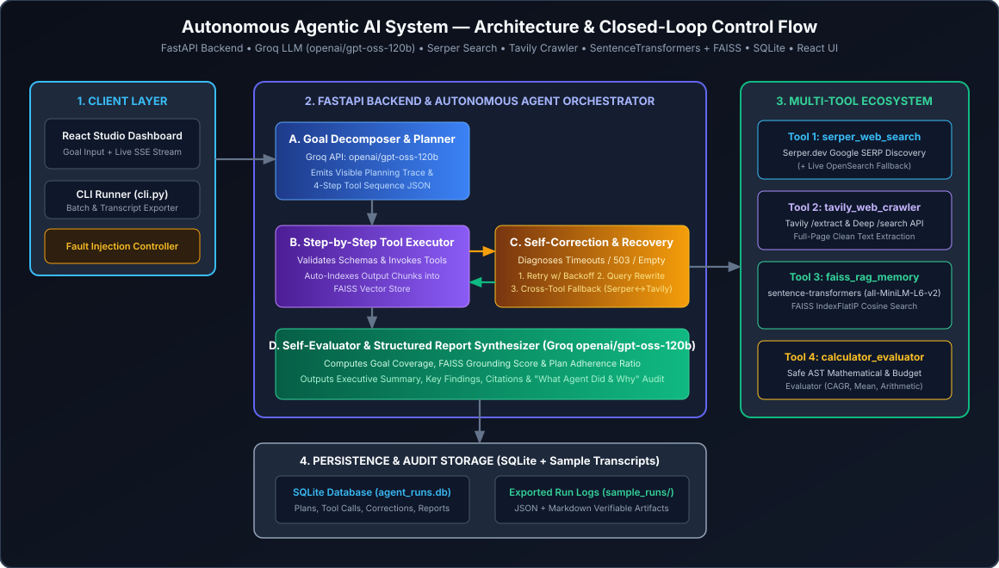
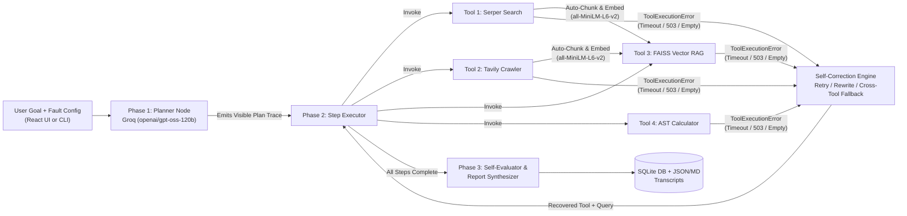

# Autonomous Agentic AI Studio
**Agentic AI Engineer Intern — Take-Home Assignment**

An end-to-end autonomous agentic system that accepts high-level natural-language goals, generates a **visible planning trace**, orchestrates **4 distinct live tools**, performs **closed-loop self-correction** when tools fail, indexes gathered evidence into a **FAISS vector store**, persists audit transcripts in **SQLite**, and outputs a **structured Markdown & JSON report** with self-evaluation metrics.



---

## 1. Tech Stack

| Layer | Technology | Role in Agentic Workflow |
| :--- | :--- | :--- |
| **Backend API** | **FastAPI** (`Python 3.11+`) | REST + real-time **Server-Sent Events (SSE)** streaming of plans, tool calls, and recovery events |
| **LLM Inference** | **Groq API** (`openai/gpt-oss-120b`) | Ultra-fast goal decomposition, planning trace generation, and structured report synthesis |
| **Tool 1: Web Search** | **Serper API** (`serper_web_search`) | Live Google SERP discovery for recent news, organic results, knowledge graphs, and target URLs |
| **Tool 2: Web Crawler** | **Tavily API** (`tavily_web_crawler`) | Deep web page extraction (`/extract` & advanced `/search`) for clean full-text content |
| **Tool 3: Vector RAG** | **SentenceTransformers** (`all-MiniLM-L6-v2`) + **FAISS** (`faiss_rag_memory`) | Chunks, deduplicates, embeds (384-d), and indexes live web data into `IndexFlatIP` for semantic retrieval |
| **Tool 4: Calculator** | **AST Math Engine** (`calculator_evaluator`) | Safe AST-based evaluator for arithmetic, budgets, means, percentages (`pct_change`), and `cagr` |
| **Persistence** | **SQLite** (`agent_runs.db`) | Stores complete run transcripts, planning traces, tool call logs, and self-correction records |
| **Frontend UI** | **React 18 + Vite** | Interactive studio with live planning trace, fault-injection controls, evaluation scorecard, and JSON viewer |

---

## 2. System Architecture & Control Flow



---

## 3. Quick Start & Run Instructions

### Prerequisites
- **Python 3.10+**
- **Node.js 18+** and `npm`

### Step 1: Backend Setup
```bash
cd backend
pip install -r requirements.txt
```

Configure your API keys in `backend/.env` (already pre-configured in this workspace, or copy from `backend/.env.example`):
```env
GROQ_API_KEY=your_groq_api_key
GROQ_MODEL=openai/gpt-oss-120b
SERPER_API_KEY=your_serper_api_key
TAVILY_API_KEY=your_tavily_api_key
```

Start the FastAPI server on port `8000`:
```bash
uvicorn main:app --reload --host 127.0.0.1 --port 8000
```

### Step 2: Frontend Setup (React Dashboard)
Open a second terminal:
```bash
cd frontend
npm install
npm run dev
```
Open **http://localhost:5173** in your browser to use the interactive studio.

### Step 3: Run via CLI (Optional Terminal Mode)
You can also execute any goal directly from the command line and export JSON + Markdown transcripts:
```bash
cd backend
python cli.py \
  --goal "Given the company Groq, produce a competitive-landscape brief comparing its LPU inference architecture against NVIDIA and Cerebras using public web data." \
  --inject-fault \
  --fault-tool serper_web_search \
  --fault-mode http_503_rate_limit \
  --output-prefix ../sample_runs/run_2_competitive_brief_fault_recovery
```

### Step 4: Run Automated Tests
```bash
cd backend
pytest tests/test_agent.py -v
```

---

## 4. Deliberate Failure Handling & Self-Correction (Requirement #3.4)

To make resilience verifiable and repeatable, the system includes a configurable **`FaultInjector`** (`backend/app/tools/base.py`) accessible from both the React UI and CLI:
1. **`http_503_rate_limit` / `malformed_payload` $\rightarrow$ Cross-Tool Fallback (`cross_tool_fallback`)**: When `serper_web_search` fails with HTTP 503, the agent logs the failure, diagnoses the upstream outage, and dynamically reroutes discovery to `tavily_web_crawler` (or vice versa).
2. **`timeout` $\rightarrow$ Backoff Retry (`retry_with_modified_params`)**: When an upstream read timeout occurs on Attempt #1, the agent diagnoses the transient fault and retries with sanitized parameters.
3. **`empty_results` $\rightarrow$ Query Reformulation (`query_reformulation`)**: When a query returns zero matches, the agent strips conversational stopwords and reformulates the query to high-recall core keywords.

---

## 5. Included Deliverables Checklist

- **Source Code:** Modular FastAPI backend (`backend/app/`) + React frontend (`frontend/src/`) + automated test suite (`backend/tests/test_agent.py`).
- **Architecture Diagram:** Vector diagram at [`docs/architecture.svg`](docs/architecture.svg) + Mermaid control-flow diagram above.
- **Sample Run Transcripts (`sample_runs/`):**
  1. [`sample_runs/run_1_ai_developments.md`](sample_runs/run_1_ai_developments.md) & [`.json`](sample_runs/run_1_ai_developments.json) — Weekly AI developments + timeout self-correction.
  2. [`sample_runs/run_2_competitive_brief_fault_recovery.md`](sample_runs/run_2_competitive_brief_fault_recovery.md) & [`.json`](sample_runs/run_2_competitive_brief_fault_recovery.json) — Groq competitive brief + HTTP 503 cross-tool failover (`serper_web_search` $\rightarrow$ `tavily_web_crawler`).
  3. [`sample_runs/run_3_tokyo_itinerary_budget.md`](sample_runs/run_3_tokyo_itinerary_budget.md) & [`.json`](sample_runs/run_3_tokyo_itinerary_budget.json) — 3-day Tokyo itinerary & budget calculation + malformed payload recovery.
- **1-Page Engineering Write-Up:** See [`WRITEUP.md`](WRITEUP.md).
